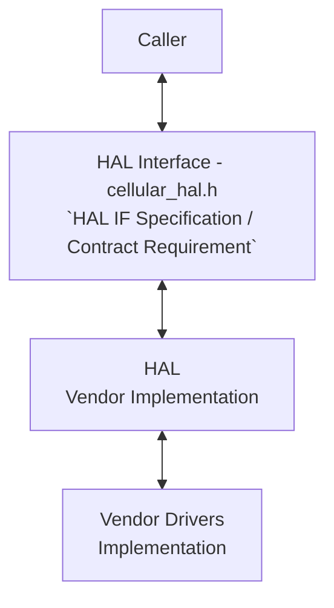
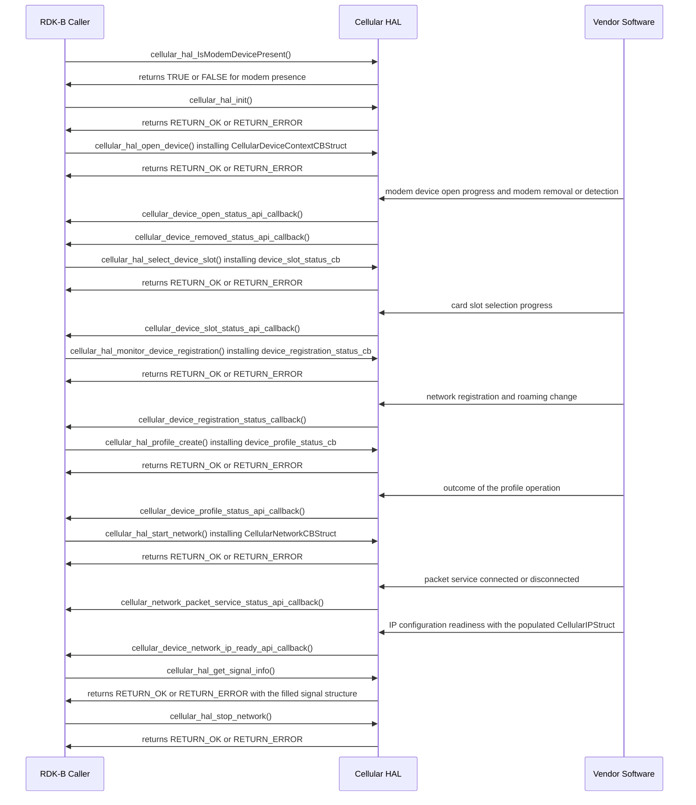

# Cellular Manager HAL Documentation

## Version History

| Date | Comment | Version |
| --- | --- | --- |
| 06/06/24 | Initial release of the Cellular Manager HAL interface, migrated to GitHub. | 1.0.0 |
| 10/09/24 | Removal of the `glib` headers from `cellular_hal.h`. | 1.0.1 |
| Unreleased | Specification restructured onto the common RDK-B HAL topic set. Asynchronous notification model, return codes, data types and the complete API surface documented. | Unreleased |

**Provenance of this page.** It was renamed from `docs/pages/CellularHalSpec.md` to `docs/pages/halSpec.md` in the same change that rewrote it against the canonical topic set. Git records a rename only where the two versions still resemble each other, and a full rewrite does not, so `git log --follow -- docs/pages/halSpec.md` begins at that change: the revisions before it are reached with `git log -- docs/pages/CellularHalSpec.md`.

Four version identities are distinct for this interface and are not interchangeable. The table above
records the **document revision**, sourced from `CHANGELOG.md` in the root of this repository, with
dates taken from this repository's release tags (`1.0.0`: 6 June 2024; `1.0.1`: 9 October 2024).
The **release tag** is `1.0.0` or `1.0.1`; those are the only two tags this repository carries. The
**generated-site version string** is whatever `git describe --tags` reports when `generate_docs.sh`
runs, which takes the form `<tag>-<commits-since-tag>-g<abbreviated-commit>` — a tag, the number of
commits made since it, and the abbreviated commit; a string of that form denotes a point after a
release and is not itself a version. It is computed when the documentation is generated and changes
with every commit, including the commit that would record it, so no literal value is reproduced
here: a reader who needs the string for the revision in front of them runs `git describe --tags`
against that revision. There is no fourth identity: `cellular_hal.h` **declares no interface version macro of any
kind**, so a caller cannot determine at compile time or at run time which revision of the interface
it has been built against. That absence is a property of the interface as published, and it is
recorded here rather than filled with an assumed value.

## Acronyms

- `HAL` \- Hardware Abstraction Layer
- `RDK-B` \- Reference Design Kit for Broadband Devices
- `OEM` \- Original Equipment Manufacturer
- `SIM` \- Subscriber Identity Module
- `UICC` \- Universal Integrated Circuit Card
- `ICCID` \- Integrated Circuit Card Identifier
- `IMEI` \- International Mobile Equipment Identity
- `MSISDN` \- Mobile Station International Subscriber Directory Number
- `PLMN` \- Public Land Mobile Network
- `APN` \- Access Point Name
- `PDP` \- Packet Data Protocol
- `NAS` \- Network Attachment Subsystem
- `RAT` \- Radio Access Technology
- `QMI` \- Qualcomm MSM Interface
- `PS` \- Packet Switched
- `CS` \- Circuit Switched
- `WAN` \- Wide Area Network

## Description

The diagram below describes a high-level software architecture of the Cellular Manager HAL module stack.

Cellular Manager HAL is an abstraction layer, implemented to interact with vendor software for
managing access to the cellular network, managing cellular modem power configuration, exposing radio
resource information of the cellular interface, managing `SIM` use and related functions.

This repository publishes the interface only. The implementation behind it is supplied by the `OEM`
or the modem vendor as a shared library, which is what makes the contract testable independently of
any one vendor's hardware.

No dedicated `RDK-B` middleware service owns this interface. Unlike the Wi-Fi, Platform, cable modem
and Ethernet switch HALs, which are each driven by a named service that must be stopped before the
`HAL` can be exercised directly, the Cellular `HAL` has no service dependency and is called directly
by whichever `RDK-B` component or test harness requires it. The `Caller` participant in the diagram
above is therefore generic by intent, not a placeholder for a service that has been omitted.

## Optional Components

The following components are optional and are subject to the compile-time configuration of the
build, or to the caller's choice at the point of call.

- `QMI` library support. `cellular_hal.h` defines `QMI_SUPPORT` only when `CELLULAR_MGR_LITE` is not
  defined. A build that defines `CELLULAR_MGR_LITE` therefore omits `QMI_SUPPORT`, and any vendor
  implementation or caller conditional that depends on that symbol is excluded with it. The header
  records `QMI` as the library supported at present, so a vendor is not obliged to support a second
  modem control library.

- The profile argument to `cellular_hal_start_network()`. Where `pstProfileInput` is `NULL`, the
  implementation is required to start the network on the default profile rather than reject the
  call, so supplying a profile is optional for a caller content with the default. The same
  convention applies to `cellular_hal_profile_create()`, whose contract selects the default profile
  when no profile is supplied.

## Component Runtime Execution Requirements

### Initialization and Startup

The initialization API below initializes the Cellular `HAL` layers and code.

- `cellular_hal_init()` \- initializes the Cellular `HAL` from a
  `CellularContextInitInputStruct` carrying the preferred IP family, the preferred access
  technology and the interface profile. It must be invoked before any other operation.

Three further calls belong to the startup path once initialization has completed.

- `cellular_hal_open_device()` \- instructs the lower layer to create and open the modem device,
  and installs the device-context callbacks described under `Asynchronous Notification Model`.
- `cellular_hal_IsModemDevicePresent()` and `cellular_hal_IsModemControlInterfaceOpened()` \-
  report whether the modem device is present and whether its control interface is open. This
  interface does not specify an ordering constraint on either call relative to the others, so a
  caller must not assume that a query is required before, or is valid only after, initialization.

Third party vendors will implement appropriately to meet operational requirements. This interface is
expected to block if the hardware is not ready.

### Threading Model

Cellular `HAL` is not thread safe. This differs from some other `RDK-B` HALs, which require the
implementation itself to be thread safe, and the difference is deliberate: the obligation here rests
with the caller.

Any module which is invoking the Cellular `HAL` API should ensure calls are made in a thread safe
manner.

Vendors may create internal threads and events to meet their operational requirements. These are
responsible for synchronizing between the calls and the events, and must be cleaned up on closure.

### Process Model

All APIs are expected to be called from multiple processes.

### Memory Model

Ownership of memory crossing this interface is split between the caller and the module as follows.

#### Caller Responsibilities

- Manage memory passed to specific functions as outlined in the API documentation. This includes
  allocation and proper deallocation to prevent leaks.
- Allocate the output structures the interface fills. Every retrieval call in this interface writes
  through a caller-supplied pointer, and the two calls that return a list —
  `cellular_hal_get_profile_list()` and
  `cellular_hal_get_available_networks_information()` — take a pointer to a pointer together with a
  count, so a caller must read the count before indexing the result.
- Copy any string or structure delivered to a callback that is needed after the callback returns.
  This interface does not state how long such a buffer remains valid, so retaining the pointer is
  not safe.

#### Module Responsibilities

- Handle and deallocate memory used for its internal operations.
- Release all internally allocated memory upon closure to prevent leaks.
- Treat every character array in the interface as zero-terminated, with the terminator included in
  the declared size, so that a caller can determine a string's length safely.

**Memory footprint:** no memory footprint limit is specified for this interface. A vendor
implementation is bound instead by the proportionality obligation stated under
`Memory and performance requirements`, and a caller must not assume a bounded allocation on the
implementation's side of the interface.

### Power Management Requirements

The Cellular `HAL` is not involved in any of the power management operations of the platform. It
neither participates in nor requires involvement in any platform power-related function.

This is distinct from modem and card power control, which is part of the functional surface:
`cellular_hal_set_modem_operating_configuration()` accepts `CELLULAR_MODEM_SET_LOW_POWER_MODE`
alongside its online, offline and reset commands, and `cellular_hal_sim_power_enable()` powers a
card slot on or off. Those calls act on the modem and the card, and they place no obligation on the
`HAL` to take part in the platform's own power management.

### Asynchronous Notification Model

This interface defines an asynchronous notification path. Notifications are delivered by callback:
the caller supplies a function pointer, either directly as an argument or as a member of a callback
container structure, to the operation that starts the activity being reported on. There is no
separate registration API, and the interface declares no means of removing a callback once it has
been installed.

Seven callback types are declared. Every one of them is a `typedef` of a function returning `int`,
and an implementation of one is expected to return `RETURN_OK` or `RETURN_ERROR` in the same way as
a call into the interface.

| Callback type | Installed by | Condition reported |
| --- | --- | --- |
| `cellular_device_open_status_api_callback` | `cellular_hal_open_device()`, as the `device_open_status_cb` member of `CellularDeviceContextCBStruct` | Modem device open progress, with the device name, the `WAN` interface name, a `CellularDeviceOpenStatus_t` and the modem operating mode |
| `cellular_device_removed_status_api_callback` | `cellular_hal_open_device()`, as the `device_remove_status_cb` member of `CellularDeviceContextCBStruct` | Modem removal or detection, as a `CellularDeviceDetectionStatus_t` against a device name |
| `cellular_device_slot_status_api_callback` | `cellular_hal_select_device_slot()`, directly | Card slot selection progress, as a `CellularDeviceSlotStatus_t` against a slot name, type and number |
| `cellular_device_registration_status_callback` | `cellular_hal_monitor_device_registration()`, directly | Network registration change, as a `CellularDeviceNASStatus_t` with the roaming status and the registered service type |
| `cellular_device_profile_status_api_callback` | `cellular_hal_profile_create()`, `cellular_hal_profile_delete()` and `cellular_hal_profile_modify()`, directly | Outcome of a profile operation, as a `CellularDeviceProfileSelectionStatus_t` against a profile identifier and `PDP` type |
| `cellular_network_packet_service_status_api_callback` | `cellular_hal_start_network()`, as the `packet_service_status_cb` member of `CellularNetworkCBStruct` | Packet service connected or disconnected, as a `CellularNetworkPacketStatus_t` against a device name and IP type |
| `cellular_device_network_ip_ready_api_callback` | `cellular_hal_start_network()`, as the `device_network_ip_ready_cb` member of `CellularNetworkCBStruct` | IP configuration readiness, as a `CellularDeviceIPReadyStatus_t` together with the populated `CellularIPStruct` |

**Threading of a callback:** this interface does not specify the thread context in which a callback
is invoked, and a caller must not assume one. Because `Threading Model` permits a vendor to create
internal threads and events, a caller must treat a callback as arriving on a thread other than the
one that installed it, and must synchronize its own state accordingly.

**Timing and ordering of a callback:** this interface specifies neither a delivery deadline nor an
ordering guarantee between callbacks, and it does not state whether a callback may be invoked more
than once for a single condition. A caller must therefore be written to tolerate repeated and
out-of-order notification.

**Buffer lifetime in a callback:** the string and structure arguments a callback receives are
supplied by the implementation. This interface does not state how long they remain valid after the
callback returns, so a caller must copy any value it needs to retain rather than storing the
pointer.

### Blocking calls

Cellular `HAL` APIs are expected to work synchronously and should complete within a time period
commensurate with the complexity of the operation and in accordance with any relevant
specification. Any call that can fail due to the lack of a response should have a timeout period in
accordance with any relevant documentation.

**Timeout target:** no numeric timeout value is specified for any call in this interface, and none
is derivable from the interface definition. A caller that must bound its own latency has to impose
that bound itself.

**The one stated blocking behaviour** is that `cellular_hal_init()` is expected to block if the
hardware is not ready. For every other call, this interface states no blocking behaviour beyond the
general expectation of synchronous completion above, and a caller must not read the absence of a
statement as a guarantee that a call returns promptly.

### Internal Error Handling

All the Cellular `HAL` APIs should return errors synchronously as a return value. While the `HAL` is
responsible for managing internal system errors, such as out of memory conditions, it is important
to note that the interface level may not always handle recovery from severe system errors
effectively. Instead, the `HAL` should prioritize graceful handling of recoverable errors and
logging critical issues for further investigation and resolution.

`cellular_hal.h` defines exactly two return codes for this purpose: `RETURN_OK`, with the value `0`,
and `RETURN_ERROR`, with the value `-1`. There is no finer-grained error enumeration, so a failure
return distinguishes neither the cause of the failure nor whether it is retryable. A caller cannot
recover a reason code from the interface and must decide its own retry and escalation policy from
the call it made.

### Persistence Model

There is no requirement for the `HAL` to persist any setting information. The application or client
is responsible for persisting any settings related to its implementation.

## Non functional requirements

The following non functional requirements should be supported by the Cellular `HAL` component.

### Logging and debugging requirements

The component should log all error and critical informative messages, preferably using `syslog`,
which helps to debug and triage issues and to understand the functional flow of the system. The use
of `printf` is discouraged unless `syslog` is not available.

The logging should be consistent across all `HAL` components.

If the vendor is going to log, it has to be logged into the `cellular_vendor_hal.log` file, which
can be placed in the `/rdklogs/logs/` directory.

Logging should be defined with log levels as per Linux standard logging. The levels, in descending
order of severity, are:

- **FATAL:** Critical conditions, typically indicating a crash or a severe failure requiring
  immediate attention.
- **ERROR:** Non-fatal error conditions that nonetheless significantly impede normal operation.
- **WARNING:** Potentially harmful situations that do not yet represent errors.
- **NOTICE:** Important but not error-level events.
- **INFO:** General informational messages that highlight system operation.
- **DEBUG:** Detailed information useful when diagnosing a problem.
- **TRACE:** Very fine-grained logging to trace the internal flow of the system.

**Values that must never be logged.** This interface carries subscriber identifiers and network
credentials. The requirements below are **normative for this interface** rather than advisory, and
they bind the vendor implementation and the `RDK-B` caller equally. They are stated here rather than
left to be inferred because the interface declares no redaction helper, no sensitivity marker and no
opaque credential type, so nothing enforces them mechanically, and because a debug line is the usual
way such a value escapes a device.

The protected class is exactly the following:

- the device identity read by `cellular_hal_get_device_imei()` and the software version digits that
  accompany it, read by `cellular_hal_get_device_imei_sv()`;
- the card and subscription identifiers read by `cellular_hal_get_modem_current_iccid()` and
  `cellular_hal_get_modem_current_msisdn()`, and the `iccid` and `msisdn` members of every
  `CellularUICCSlotInfoStruct` filled by `cellular_hal_get_uicc_slot_info()`;
- the authentication credentials and network configuration carried in the packet data protocol
  context profile `CellularProfileStruct` — its `APN`, its `Username`, its `Password` and its
  `Proxy` address — and in `CellularContextInitInputStruct`, which embeds one as its `stIfInput`
  member, on every call that takes or returns either, which is `cellular_hal_init()`,
  `cellular_hal_profile_create()`, `cellular_hal_profile_delete()`,
  `cellular_hal_profile_modify()`, `cellular_hal_get_profile_list()` and
  `cellular_hal_start_network()`.

`cellular_hal.h` declares no accessor for the `IMSI` and carries no `IMSI` member in any structure,
so this interface exposes no subscriber identity behind the card identifier; if a vendor path outside
this interface makes one available, it belongs to the same class and is handled on the same terms.

Every member of that class is handled on the following terms:

- **The value, and every fragment, hash or length of it, is prohibited at every severity.** Neither
  an implementation nor a caller may write a protected value — whole, truncated, prefixed, suffixed,
  first-and-last character, encoded, encrypted, hashed, or reduced to a character count or a checksum
  — to `cellular_vendor_hal.log`, to `syslog`, to a `printf` fallback, to standard output, to
  standard error, to a trace buffer, to a `PDP` or modem transaction trace, or to any error or
  exception message it constructs or propagates. This holds at every level of the ladder above,
  `DEBUG` and `TRACE` included: a value too sensitive for `INFO` is not made acceptable by lowering
  the severity, and a verbose or debug build is not a build in which these values may be logged. A
  fragment is prohibited for the same reason as the value: the trailing digits of an `ICCID` or an
  `MSISDN` are the part that distinguishes one subscriber from another, so publishing a suffix is
  publishing the identification, and a length alone distinguishes an `IMEI` from an `ICCID` and one
  credential format from another.
- **A message that must refer to a protected value names the item and redacts the value.** Where a
  log line has to identify which profile, slot or subscription an event concerns, it records the
  operation, the outcome and a non-identifying reference — the `ProfileID`, the slot index, the
  `PDPContextNumber` — and never the value. One **fixed redaction marker, the literal `[REDACTED]`**,
  identical for every value and of a length unrelated to the value it replaces, is written in its
  place: because the same
  marker stands for a value from the 16-byte `imei` buffer and for one from the 21-byte `iccid`
  buffer alike, it discloses neither the content nor the shape of what it hides.
- **A rejected or malformed value is not logged either.** A failed profile creation or a rejected
  credential is the case most likely to prompt an implementer to log the offending input, and the
  case where doing so is most damaging: a rejected credential is frequently valid for another
  profile, another device or another subscription. The verdict is logged; the input is not.
- **Protected values are excluded from crash artefacts, support bundles and telemetry.** A core
  dump, a minidump, a stack dump, a heap dump, a post-mortem or exception report, and a support or
  bug-report bundle must not carry a protected value or any fragment, hash or length of one; neither
  may any telemetry, analytics, metric, metric label or usage report. This is a separate obligation
  from the logging rule and it fails separately — an implementation with disciplined logging still
  discloses everything if it uploads an unfiltered core or tags a metric with a subscription number.
  Where a platform's crash handler cannot be constrained, the value must not be resident when an
  artefact can be taken, which is what the clearing rule below achieves as early as its sequencing
  safely permits. Where retention is unresolved that window cannot be closed on return, which is why
  the rule below requires the retention question to be settled with the implementer rather than
  answered by an early overwrite.
- **Protected values are cleared, and the order in which they are cleared is part of the
  requirement.** Two kinds of storage hold these values and they are not cleared at the same moment,
  so an instruction to "clear after use" would tell a caller to do something this interface makes
  unsafe.
  - **A copy the caller itself made is the caller's own storage.** No part of this interface holds a
    pointer to it, so the caller overwrites each copy as soon as it has finished with that copy, on
    every path including the failure path, because a failed read may have left part of a value
    behind. This case is unconditional, and it is the one to prefer: a caller that needs an `IMEI`,
    an `ICCID`, an `MSISDN` or a profile credential for longer than the supplied storage can safely
    hold it takes its own copy, works from the copy, and erases the copy.
  - **Storage the caller passed to a call, or supplied for a call to fill, is storage whose retention
    this interface does not settle.** No declaration in `cellular_hal.h` states how long the
    implementation may use the pointer, so the caller overwrites the `imei`, `imei_sv`, `iccid` and
    `msisdn` buffers, the `CellularUICCSlotInfoStruct` it supplied and the `CellularProfileStruct` or
    `CellularContextInitInputStruct` it passed **once the implementation's use of that storage has
    ended — and immediately once it has.** That point is the return of the call where non-retention
    has been established by inspection of the implementation or by contract with the vendor; it is
    the completion reported at the installed handler for `cellular_hal_profile_create()`,
    `cellular_hal_profile_delete()`, `cellular_hal_profile_modify()` and
    `cellular_hal_start_network()`, which finish asynchronously; and it is otherwise the release that
    ends the use.
  - **Clearing passed or supplied storage on return, while retention is still unresolved, is not the
    conservative reading of this rule.** If the implementation does hold the pointer, the overwrite
    lands in a read or a write it is still performing: the profile description changes under the
    profile call that is still consuming it, or the identifier buffer changes under the write that is
    still filling it, and a caller that followed the security rule literally has introduced the
    corruption the rule exists to prevent. Until retention is settled the caller keeps that
    allocation dedicated to the value — not released to a general-purpose allocator, not reused for
    unrelated data, not handed to a component with no need of it — and settles the question with the
    implementer as part of integrating it, rather than leaving the value resident indefinitely or
    clearing it early.
  - **The array `cellular_hal_get_profile_list()` returns is the exception, because it is not the
    caller's storage at all.** `cellular_hal.h` states that the ownership of that allocation is
    unspecified and that the interface declares no matching free function, so a caller neither
    overwrites nor frees it: writing into storage whose owner is unsettled may corrupt memory the
    implementation still uses, and this interface names no point at which that becomes safe. A caller
    clears its own copies of the entries on the terms above and settles the array's ownership and
    erasure with the implementer.
  - **No protected value is given a longer-lived home in the first place.** It is not copied into a
    data-model cache, a configuration file, an environment variable, a message queue, a retry buffer,
    a `URL` or a filename, and is not passed to a component that has no need of it; and an
    implementation must not pass a protected value to a lower layer that logs it.
- **The interface guarantees none of this.** It declares no scrubbing function, no opaque credential
  type and no flag by which a caller could ask an implementation to suppress its own logging, and it
  provides no way to verify that an implementation observes these rules. A caller integrating a
  vendor implementation must therefore establish compliance by inspection or by contract rather than
  assume it, and must treat the absence of these values from a vendor log, core or telemetry feed as
  unverified until it has done so.

This is a requirement on both parties rather than a recommendation to either, and it holds
independently of the `Persistence Model`: nothing in this interface persists these values, so a copy
that outlives the call is one the caller or the implementer created.

*Derived from `cellular_hal.h` — the interface-wide sensitive-value statement in the `CELLULAR_HAL`
group block, the warnings on `CellularProfileStruct` and `CellularUICCSlotInfoStruct`, and the
warnings on `cellular_hal_get_device_imei`, `cellular_hal_get_device_imei_sv`,
`cellular_hal_get_modem_current_iccid`, `cellular_hal_get_modem_current_msisdn`,
`cellular_hal_get_uicc_slot_info`, `cellular_hal_init`, `cellular_hal_profile_create`,
`cellular_hal_profile_delete`, `cellular_hal_profile_modify`, `cellular_hal_get_profile_list` and
`cellular_hal_start_network` — together with the logging requirements carried by the previous
revision of this page. The absence of an `IMSI` accessor is a statement about `cellular_hal.h`, which
declares none.*

### Memory and performance requirements

The Cellular `HAL` must not contribute disproportionately to memory or CPU utilization while
performing normal operations, and its consumption should be commensurate with the operation
required.

### Quality Control

To ensure the highest quality and reliability, it is strongly recommended that third-party quality
assurance tools such as `Coverity`, `Black Duck` and `Valgrind` be employed to thoroughly analyze
the implementation. The goal is to detect and resolve potential issues such as memory leaks, memory
corruption or other defects before deployment.

Furthermore, both the `HAL` wrapper and any third-party software interacting with it must prioritize
robust memory management practices. This includes meticulous allocation, deallocation and error
handling to guarantee a stable and leak-free operation.

**Keeping this document accurate.** Every topic in this specification is derived from a named source:
`cellular_hal.h` for the interface surface, its data types and its return codes; `CHANGELOG.md` and
this repository's tags for `Version History`; and `docs/generate_docs.sh` for the generated-site
version string. Any change to one of those files obliges a review of the topics that cite it. The
reviewer responsible is the owner recorded in `.github/CODEOWNERS`, which assigns this repository to
`@rdkcentral/rdkb-hal-advisory`.

**Limit on verification.** The Cellular `HAL` is not available on the `HUB6` or `XER10` reference
platforms, so its behaviour cannot be exercised on that reference hardware. Every runtime statement
in this document is consequently derived from the interface definition — from the declarations,
types and comments in `cellular_hal.h` and from the policy statements this specification itself sets
out — and none of it is presented as observed behaviour. Where the interface definition establishes
nothing, this document says so rather than supplying a plausible value.

### Licensing

The Cellular `HAL` implementation is expected to be released under the Apache License 2.0.

### Build Requirements

The source code should be capable of, but not be limited to, building under the Yocto distribution
environment. The recipe should deliver a shared library named `cellularmanager.so`.

### Variability Management

The role of adjusting the interface, guided by versioning, rests solely within architecture
requirements. Thereafter, vendors are obliged to align their implementation with a designated
version of the interface. As per Service Level Agreement (SLA) terms, they may transition to newer
versions based on demand needs.

Each API interface will be versioned using [Semantic Versioning 2.0.0](https://semver.org/spec/v2.0.0.html); the
vendor code will comply with a specific version of the interface. Note that the versioning applies
to the published interface, not to a symbol inside it: `cellular_hal.h` declares no version macro,
so the version a caller has been built against cannot be read from the header at compile time or
queried at run time.

One compile-time variability point exists in the interface itself. `CELLULAR_MGR_LITE` is the
controlling symbol, and it is never defined by `cellular_hal.h`; it is supplied by the build.

- When `CELLULAR_MGR_LITE` is **not** defined, `cellular_hal.h` defines `QMI_SUPPORT`, declaring that
  the `QMI` library is the supported modem control library.
- When `CELLULAR_MGR_LITE` **is** defined, `QMI_SUPPORT` is not defined, and any vendor code or
  caller conditional guarded by that symbol is excluded from the build.

No declaration, data type or return code in this interface is added or removed by that symbol; it
gates only the `QMI_SUPPORT` definition, so the API surface documented here is the same in both
configurations.

### Platform or Product Customization

No platform-specific or product-specific customization is specified for this interface. The
interface declares no product conditional, no platform conditional and no vendor extension point,
and the entire API surface, data type set and return code set documented here is present on every
platform that ships this header. The single compile-time variation available is `CELLULAR_MGR_LITE`,
described under `Variability Management`, and it changes no part of the API surface.

Where a platform needs behaviour this interface does not express, that behaviour belongs behind the
vendor implementation and is not visible to a caller through these declarations.

## Interface API Documentation

All `HAL` function prototypes and datatype definitions are available in the
[`cellular_hal.h`](../../include/cellular_hal.h) file.

1. Components and processes must include `cellular_hal.h` to make use of Cellular Manager `HAL`
   capabilities.
2. Components and processes should add a linker dependency on `cellularmanager.so`.

The topics above answer what this interface is and how to bring it up. The topics from `API Surface`
onward are the reference depth: the complete declared surface, the types a caller has to construct
or interpret, the call sequence and the status values the interface reports. Per-API detail — the
argument ranges, buffer sizes, pre-conditions and per-code return semantics — is carried by the
inline documentation on each declaration in `cellular_hal.h`, which is the authority for anything
this page summarizes.

### Theory of operation and key concepts

The Cellular `HAL` presents the cellular modem, its cards and its packet data connectivity as a flat
set of C functions over an implicit, singleton device context. A caller initializes the layer, opens
the modem device, selects a card slot, configures a `PDP` context profile and starts a packet data
network; thereafter it reads signal, cell, registration and statistics values, and receives
asynchronous notification of the conditions listed under `Asynchronous Notification Model`.

#### Object Lifecycles

| Aspect | Description |
| --- | --- |
| **Creation** | The `cellular_hal_init()` function initializes the Cellular `HAL`, configuring necessary resources and setting up any initial states required for operation. This function expects a `CellularContextInitInputStruct` containing initial configuration details. |
| **Usage** | The initialized instance is then used for further cellular operations, such as managing network connections, querying device status and handling cellular events. |
| **Destruction** | Resources are managed internally; however, there is no explicit function for deinitialization provided in the header for clean-up. The interface declares no counterpart to `cellular_hal_init()` — the only stop-side call is `cellular_hal_stop_network()`, which stops a packet data network and does not tear down the layer. Applications must therefore handle clean-up internally as necessary when the cellular functionality is no longer required or before the application terminates. |
| **Unique Identifiers** | The system does not explicitly define a unique identifier for `HAL` instances in the interface; operations are globally applicable to the system's cellular capabilities. Identifiers exist below that level — a slot identifier, a profile identifier and a `PDP` context number — and the header defines the sentinels `CELLULAR_SLOT_ID_UNKNOWN`, `CELLULAR_PROFILE_ID_UNKNOWN` and `CELLULAR_PDP_CONTEXT_UNKNOWN` for the case where one is not present. |

#### Method Sequencing

| Aspect | Description |
| --- | --- |
| **Initialization** | `cellular_hal_init()` must be invoked before any other operation. This setup is crucial as it prepares the cellular module for subsequent commands and configurations. |
| **Logical Order** | Post-initialization, methods such as `cellular_hal_open_device()` and `cellular_hal_start_network()` should be called to establish network connectivity. Configuration changes typically precede action commands, such as setting parameters before starting a session or applying changes. |
| **Callback Installation** | A callback is installed by the very call that begins the activity it reports on, and there is no separate registration API. Consequently a caller that wants notification of an event must issue the corresponding operation, and once installed a callback cannot be removed — the interface declares no deregistration call. |
| **Unspecified Ordering** | Beyond the initialization constraint above, this interface does not specify a required ordering between its calls. A caller must not infer, for example, that a card slot must be selected before a profile is created, or that registration monitoring must begin before a network is started; where such an ordering matters on a given platform it is a property of the vendor implementation, not of this interface. |

#### State-Dependent Behavior

| Aspect | Description |
| --- | --- |
| **Implicit State Model** | The `HAL` maintains internal states that are not explicitly detailed in the API but are implied by the functions available. For example, the modem must be initialized and in a ready state before certain actions can be performed. |
| **State-Dependent Methods** | Many operations implicitly require the modem to be in specific states. For example, network operations like `cellular_hal_start_network()` can only be executed successfully if the device is correctly initialized and not currently in an error state. |
| **Error Handling** | The API functions return either `RETURN_OK` or `RETURN_ERROR`, indicating success or failure; these are the only two codes the header defines, and `cellular_hal_IsModemDevicePresent()` and `cellular_hal_IsModemControlInterfaceOpened()` are the two exceptions, returning `TRUE` or `FALSE` instead. Detailed error handling is essential, and methods should include robust checks to ensure that operations are performed in valid states. |

### Data Structures and Defines

Every public type below is declared in `cellular_hal.h` under the `CELLULAR_HAL_TYPES` documentation
group. A caller constructs the input structures and configuration enumerations itself, and reads the
output structures and status enumerations the interface fills. Field-level detail — units, valid
ranges and buffer sizes — is carried by the inline documentation on each member in the header.

**Input structures a caller constructs**

| Type | Represents |
| --- | --- |
| `CellularContextInitInputStruct` | The initialization input to `cellular_hal_init()`: the preferred IP family, the preferred access technology and an embedded interface profile. |
| `CellularProfileStruct` | A `PDP` context profile: profile identifier and type, `PDP` context number, `PDP` type, authentication and network configuration, profile name, `APN`, credentials, proxy address and port, and the roaming, `APN`-disabled and default-profile flags. Supplied to the profile calls and to `cellular_hal_start_network()`, and returned by `cellular_hal_get_profile_list()`. |
| `CellularDeviceContextCBStruct` | The callback container passed to `cellular_hal_open_device()`, carrying `device_open_status_cb` and `device_remove_status_cb`. |
| `CellularNetworkCBStruct` | The callback container passed to `cellular_hal_start_network()`, carrying `device_network_ip_ready_cb` and `packet_service_status_cb`. |

**Output structures the interface fills**

| Type | Represents | Filled by |
| --- | --- | --- |
| `CellularIPStruct` | A complete IP configuration: `WAN` interface name, address, IP type, subnet mask, default gateway, two name servers, domains and the maximum transmission unit size. | `cellular_device_network_ip_ready_api_callback` |
| `CellularPacketStatsStruct` | Byte, packet and dropped-packet counters in both directions, with the maximum upstream and downstream bit rates. | `cellular_hal_get_packet_statistics()` |
| `CellularUICCSlotInfoStruct` | One card slot: slot and card enable flags, card presence, form factor, application type, card status, operator name, `ICCID` and `MSISDN`. | `cellular_hal_get_uicc_slot_info()` |
| `CellularSignalInfoStruct` | Signal measurements — received strength, received quality, received power, signal-to-noise ratio and transmit power. | `cellular_hal_get_signal_info()` |
| `CellLocationInfoStruct` | Cell location identifiers: global cell identifier, band information and serving cell identifier. | `cellular_hal_get_cell_location_info()` |
| `CellularCurrentPlmnInfoStruct` | The serving network: `PLMN` name, Mobile Country Code and Mobile Network Code, registration status, registered service type, roaming flag, area code and cell identifier. | `cellular_hal_get_current_plmn_information()` |
| `CellularNetworkScanResultInfoStruct` | One scan result: network name, Mobile Country Code, Mobile Network Code and whether the network is allowed. | `cellular_hal_get_available_networks_information()` |

**Two of these types carry sensitive values, and both parties are bound in handling them.**
`CellularProfileStruct` carries the `APN`, the user name, the password and the proxy address of a
`PDP` context; `CellularUICCSlotInfoStruct` carries the `ICCID` and the `MSISDN` of a card slot.
Neither the implementer nor the caller may write any of those members to a log at any severity, place
one in a diagnostic or telemetry record, or include one in an error message; where a reference is
unavoidable the value is redacted, and a caller clears its own copy of the structure as soon as it
has finished with that copy, and a structure it passed to or supplied for a call once the
implementation's use of that storage has ended. The full obligation, its sequencing, and the list of
every call that carries one of these values are stated under
`Logging and debugging requirements`.

**Configuration enumerations a caller supplies**

| Type | Represents |
| --- | --- |
| `CellularIpFamilyPref_t` | Preferred IP family, as the `enIPFamilyPreference` member of `CellularContextInitInputStruct`. |
| `CellularPrefAccessTechnology_t` | Preferred access technology, as the `enPreferenceTechnology` member of `CellularContextInitInputStruct`, spanning second-generation packet data through to 5G New Radio. |
| `CellularProfileType_t` | Profile family — 3GPP or 3GPP2 — as a member of `CellularProfileStruct`. |
| `CellularPDPType_t` | `PDP` address type, as a member of `CellularProfileStruct` and as an argument to `cellular_device_profile_status_api_callback`. |
| `CellularPDPAuthentication_t` | `PDP` authentication method — none, Password Authentication Protocol or Challenge-Handshake Authentication Protocol — as a member of `CellularProfileStruct`. |
| `CellularPDPNetworkConfig_t` | Source of the `PDP` network configuration, as a member of `CellularProfileStruct`. |
| `CellularModemOperatingConfiguration_t` | The operating command applied by `cellular_hal_set_modem_operating_configuration()`, and the operating mode reported by `cellular_device_open_status_api_callback`. |
| `CellularNetworkIPType_t` | IP family of a packet data network, taken by `cellular_hal_start_network()` and `cellular_hal_stop_network()`, carried in `CellularIPStruct` and reported by `cellular_network_packet_service_status_api_callback`. |
| `CellularUICCFormFactor_t` | Physical card form factor, as a member of `CellularUICCSlotInfoStruct`. |
| `CellularUICCApplication_t` | Card application type — Universal, IP Multimedia or embedded Subscriber Identity Module — as a member of `CellularUICCSlotInfoStruct`. |

**Status enumerations the interface reports.** Thirteen enumerations carry reported state. Twelve are
enumerated with their members and their reporting call under `State Diagram`; the thirteenth is
`CellularModemRegisteredServiceType_t`, whose members are
`CELLULAR_MODEM_REGISTERED_SERVICE_NONE`, `CELLULAR_MODEM_REGISTERED_SERVICE_PS` for a `PS`
registration, `CELLULAR_MODEM_REGISTERED_SERVICE_CS` for a `CS` registration and
`CELLULAR_MODEM_REGISTERED_SERVICE_CS_PS` for both. It is delivered as the third argument to
`cellular_device_registration_status_callback` and as the `registered_service` member of
`CellularCurrentPlmnInfoStruct`, and a caller that implements that callback must be able to
interpret it.

**Callback types, each listed with the call that installs it**

| Callback type | Installed by |
| --- | --- |
| `cellular_device_open_status_api_callback` | `cellular_hal_open_device()`, via `CellularDeviceContextCBStruct` |
| `cellular_device_removed_status_api_callback` | `cellular_hal_open_device()`, via `CellularDeviceContextCBStruct` |
| `cellular_device_slot_status_api_callback` | `cellular_hal_select_device_slot()`, directly |
| `cellular_device_registration_status_callback` | `cellular_hal_monitor_device_registration()`, directly |
| `cellular_device_profile_status_api_callback` | `cellular_hal_profile_create()`, `cellular_hal_profile_delete()`, `cellular_hal_profile_modify()`, directly |
| `cellular_network_packet_service_status_api_callback` | `cellular_hal_start_network()`, via `CellularNetworkCBStruct` |
| `cellular_device_network_ip_ready_api_callback` | `cellular_hal_start_network()`, via `CellularNetworkCBStruct` |

**Valued macros**

| Macro | Value | Purpose |
| --- | --- | --- |
| `RETURN_OK` | `0` | Success return code, used by every call except the two that return `TRUE` or `FALSE`. |
| `RETURN_ERROR` | `-1` | Failure return code. The interface defines no other failure value and no reason code. |
| `TRUE` | `1` | Returned by `cellular_hal_IsModemDevicePresent()` and `cellular_hal_IsModemControlInterfaceOpened()`, and the set value of the unsigned char flags in the interface's structures. Defined only if not already defined. |
| `FALSE` | `0` | The complement of `TRUE`, on the same terms. |
| `BUFLEN_8`, `BUFLEN_32`, `BUFLEN_64`, `BUFLEN_128`, `BUFLEN_256` | `8`, `32`, `64`, `128`, `256` | Buffer length constants, each defined only if not already defined. The per-argument buffer size a call requires is stated on that argument in the header and is not always one of these values. |
| `CELLULAR_PROFILE_ID_UNKNOWN` | `-1` | Sentinel for a profile identifier that is not present. |
| `CELLULAR_SLOT_ID_UNKNOWN` | `-1` | Sentinel for a slot identifier that is not present. |
| `CELLULAR_PDP_CONTEXT_UNKNOWN` | `-1` | Sentinel for a `PDP` context that is not present. |
| `CELLULAR_PACKET_DATA_INVALID_HANDLE` | `0xFFFFFFFF` | Sentinel for an invalid packet data handle. |

`CELLULAR_MGR_LITE` is the one further symbol a build may define. It is described under
`Variability Management` and is never defined by the header itself.

### API Surface

`cellular_hal.h` declares 36 functions, grouped below by functional area. Every declaration returns
`int` and reports `RETURN_OK` or `RETURN_ERROR`, with the two exceptions noted explicitly. The
argument ranges, buffer sizes, pre-conditions and per-code return semantics for each call are carried
by the inline documentation on its declaration in
[`cellular_hal.h`](../../include/cellular_hal.h).

**Modem detection and initialization**

- `cellular_hal_IsModemDevicePresent()` \- reports whether a modem device is present. This call
  returns a value rather than a status: `TRUE` if a modem device is present, `FALSE` if it is not.
- `cellular_hal_init()` \- initializes the Cellular `HAL` from a `CellularContextInitInputStruct`.

**Device and control-interface lifecycle**

- `cellular_hal_open_device()` \- instructs the lower layer to create and open the modem device,
  installing the device open and device removed callbacks.
- `cellular_hal_IsModemControlInterfaceOpened()` \- reports whether the modem control interface is
  open. This call also returns a value rather than a status: `TRUE` if the interface is open,
  `FALSE` if it is not.

**SIM, UICC and slot handling**

- `cellular_hal_select_device_slot()` \- selects the card slot to use, reporting progress through the
  slot status callback.
- `cellular_hal_sim_power_enable()` \- powers a card slot on or off by slot identifier.
- `cellular_hal_get_total_no_of_uicc_slots()` \- reports how many `UICC` slots the device has.
- `cellular_hal_get_uicc_slot_info()` \- fills a `CellularUICCSlotInfoStruct` for one slot index.
- `cellular_hal_get_active_card_status()` \- reports the active card's status as a
  `CellularUICCStatus_t`.

**Network registration monitoring**

- `cellular_hal_monitor_device_registration()` \- instructs the lower layer to monitor network
  registration and installs the registration status callback.

**Profile lifecycle**

- `cellular_hal_profile_create()` \- creates a `PDP` context profile, or selects the default profile
  where none is supplied.
- `cellular_hal_profile_delete()` \- deletes the supplied profile.
- `cellular_hal_profile_modify()` \- modifies the supplied profile.
- `cellular_hal_get_profile_list()` \- returns the configured profiles together with a count.

**Network start and stop**

- `cellular_hal_start_network()` \- starts the packet data network for an IP type, on the supplied
  profile or on the default profile where none is supplied, and installs the packet service status
  and IP ready callbacks.
- `cellular_hal_stop_network()` \- stops the packet data network for the given IP request type.

**Radio resource and signal information**

- `cellular_hal_get_signal_info()` \- fills a `CellularSignalInfoStruct` with the current signal
  measurements.
- `cellular_hal_get_cell_location_info()` \- fills a `CellLocationInfoStruct` with the cell and band
  identifiers.
- `cellular_hal_get_packet_statistics()` \- fills a `CellularPacketStatsStruct` with the traffic
  counters and maximum bit rates.
- `cellular_hal_get_current_modem_interface_status()` \- reports the modem interface status as a
  `CellularInterfaceStatus_t`.
- `cellular_hal_get_current_plmn_information()` \- fills a `CellularCurrentPlmnInfoStruct` with the
  serving network's identity, registration status and registered service type.

**Modem configuration and attach**

- `cellular_hal_set_modem_operating_configuration()` \- applies an operating command to the modem:
  online, offline, low power mode, reset or factory reset.
- `cellular_hal_set_modem_network_attach()` \- attaches the modem to the network.
- `cellular_hal_set_modem_network_detach()` \- detaches the modem from the network.

**Identity queries**

- `cellular_hal_get_device_imei()` \- reads the device `IMEI` into a caller-supplied buffer.
- `cellular_hal_get_device_imei_sv()` \- reads the device `IMEI` together with its software version
  digits.
- `cellular_hal_get_modem_current_iccid()` \- reads the `ICCID` of the active card.
- `cellular_hal_get_modem_current_msisdn()` \- reads the `MSISDN` of the active subscription.
- `cellular_hal_get_modem_firmware_version()` \- reads the modem firmware version.

The first four calls in that group return subscriber identifiers, and the buffer each one fills is
the caller's. Neither the implementer nor the caller may log the value at any severity, copy it into
a diagnostic or telemetry record, or include it in an error message, and the caller must overwrite
any copy it made as soon as it has finished with that copy, and the buffer it supplied once it has
finished with the value and the implementation's use of that buffer has ended. `cellular_hal_get_modem_firmware_version()` is not in
that class: it reports the modem's firmware revision, which identifies no subscriber. The same
obligation applies to `cellular_hal_get_uicc_slot_info()` and to the five profile-carrying calls, and
is stated in full under `Logging and debugging requirements`.

**Network scan and radio access technology**

- `cellular_hal_get_available_networks_information()` \- returns the networks found by a scan,
  together with a count.
- `cellular_hal_get_modem_preferred_radio_technology()` \- reads the preferred `RAT`.
- `cellular_hal_set_modem_preferred_radio_technology()` \- sets the preferred `RAT`.
- `cellular_hal_get_modem_current_radio_technology()` \- reads the `RAT` currently in use.
- `cellular_hal_get_modem_supported_radio_technology()` \- reads the set of RATs the modem supports.

**Reset**

- `cellular_hal_modem_factory_reset()` \- resets the modem to factory defaults.
- `cellular_hal_modem_reset()` \- resets the modem.

### Sequence Diagram

The exchange below shows a representative bring-up, a read and a teardown. Every arrow in it is an
interaction this interface establishes, and each one is labelled with what that interaction carries:
a caller-to-`HAL` arrow names the declared function being called, a `HAL`-to-caller arrow names
either that function's return value or the callback typedef the notification is delivered on, and a
vendor-to-`HAL` arrow names the condition being reported.

Two things are deliberately **not** drawn. There is no `HAL`-to-vendor arrow for any of the nine
calls, because this interface specifies only what crosses its own boundary and states nothing about
what an implementation does below it — no message, no command set and no transport is named
anywhere in `cellular_hal.h`, so any such arrow would be an invented step. And no arrow is drawn for
a condition the interface declares no callback for, which is why `cellular_hal_stop_network()` and
the read calls end at their return value.

The notifications are the asynchronous deliveries described under `Asynchronous Notification Model`;
they arrive on the callbacks installed by the call that starts the activity being reported on and
are not return values of that call.

*Derived from the nine declarations named in the diagram and the seven callback typedefs tabulated
under `Asynchronous Notification Model`, all in
[`cellular_hal.h`](../../include/cellular_hal.h); the return vocabulary is the two codes named under
`Internal Error Handling`.*

### State Diagram

No state diagram is drawn for this interface, and the omission is deliberate. This interface exposes
status **values** that a caller can read or be notified of; it does not establish a state machine.
It defines no set of legal transitions, no ordering guarantee between one value and the next, no
initial state and no terminal state, and it declares no query for the layer's own overall state. A
diagram would therefore have to invent its edges, and an invented transition set is worse than none:
it reads as a contract a vendor never agreed to and a caller cannot rely on.

The status enumerations the interface reports are the following. The ordinal ordering of the members
within an enumeration must not be read as a transition sequence — that several of them happen to
read as a progression is a naming artefact, not a specified behaviour.

| Enumeration | Members | Reported by |
| --- | --- | --- |
| `CellularInterfaceStatus_t` | `IF_UP`, `IF_DOWN`, `IF_UNKNOWN`, `IF_DORMANT`, `IF_NOTPRESENT`, `IF_LOWERLAYERDOWN`, `IF_ERROR` | `cellular_hal_get_current_modem_interface_status()` |
| `CellularRegistrationStatus_t` | `DEVICE_REGISTERED`, `DEVICE_NOT_REGISTERED` | The `registration_status` member of `CellularCurrentPlmnInfoStruct`, filled by `cellular_hal_get_current_plmn_information()` |
| `CellularUICCStatus_t` | `CELLULAR_UICC_STATUS_VALID`, `CELLULAR_UICC_STATUS_BLOCKED`, `CELLULAR_UICC_STATUS_ERROR`, `CELLULAR_UICC_STATUS_EMPTY` | `cellular_hal_get_active_card_status()`, and the `Status` member of `CellularUICCSlotInfoStruct` |
| `CellularDeviceDetectionStatus_t` | `DEVICE_DETECTED`, `DEVICE_REMOVED` | `cellular_device_removed_status_api_callback` |
| `CellularDeviceOpenStatus_t` | `DEVICE_OPEN_STATUS_NOT_READY`, `DEVICE_OPEN_STATUS_INPROGRESS`, `DEVICE_OPEN_STATUS_READY` | `cellular_device_open_status_api_callback` |
| `CellularDeviceSlotStatus_t` | `DEVICE_SLOT_STATUS_NOT_READY`, `DEVICE_SLOT_STATUS_SELECTING`, `DEVICE_SLOT_STATUS_READY` | `cellular_device_slot_status_api_callback` |
| `CellularDeviceNASStatus_t` | `DEVICE_NAS_STATUS_NOT_REGISTERED`, `DEVICE_NAS_STATUS_REGISTERING`, `DEVICE_NAS_STATUS_REGISTERED` | `cellular_device_registration_status_callback` |
| `CellularDeviceNASRoamingStatus_t` | `DEVICE_NAS_STATUS_ROAMING_OFF`, `DEVICE_NAS_STATUS_ROAMING_ON` | `cellular_device_registration_status_callback` |
| `CellularContextProfileStatus_t` | `PROFILE_STATUS_INACTIVE`, `PROFILE_STATUS_ACTIVE` | Declared but reported by no call and carried in no structure. A caller has no way to obtain this value through the published interface. |
| `CellularDeviceProfileSelectionStatus_t` | `DEVICE_PROFILE_STATUS_NOT_READY`, `DEVICE_PROFILE_STATUS_CONFIGURING`, `DEVICE_PROFILE_STATUS_READY`, `DEVICE_PROFILE_STATUS_DELETED` | `cellular_device_profile_status_api_callback` |
| `CellularDeviceIPReadyStatus_t` | `DEVICE_NETWORK_IP_NOT_READY`, `DEVICE_NETWORK_IP_READY` | `cellular_device_network_ip_ready_api_callback` |
| `CellularNetworkPacketStatus_t` | `DEVICE_NETWORK_STATUS_DISCONNECTED`, `DEVICE_NETWORK_STATUS_CONNECTED` | `cellular_network_packet_service_status_api_callback` |

`CellularModemRegisteredServiceType_t` is reported alongside the `NAS` status by the same
registration callback and carries no transition semantics either; its members are listed under
`Data Structures and Defines`.

The one ordering constraint this interface does establish is the initialization constraint recorded
under `Method Sequencing`: `cellular_hal_init()` precedes every other operation. That is a
constraint on the caller's call order, not a state transition, and it is documented there rather
than reproduced as a diagram here.
