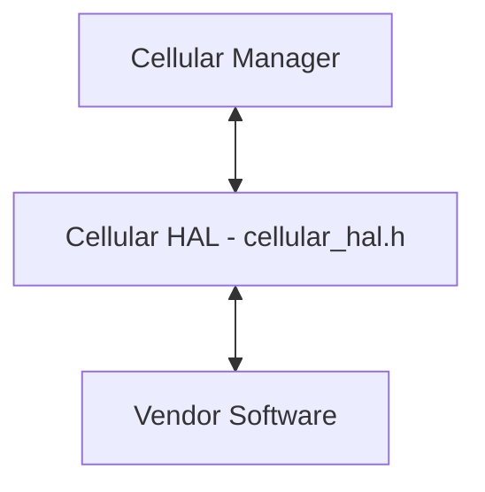
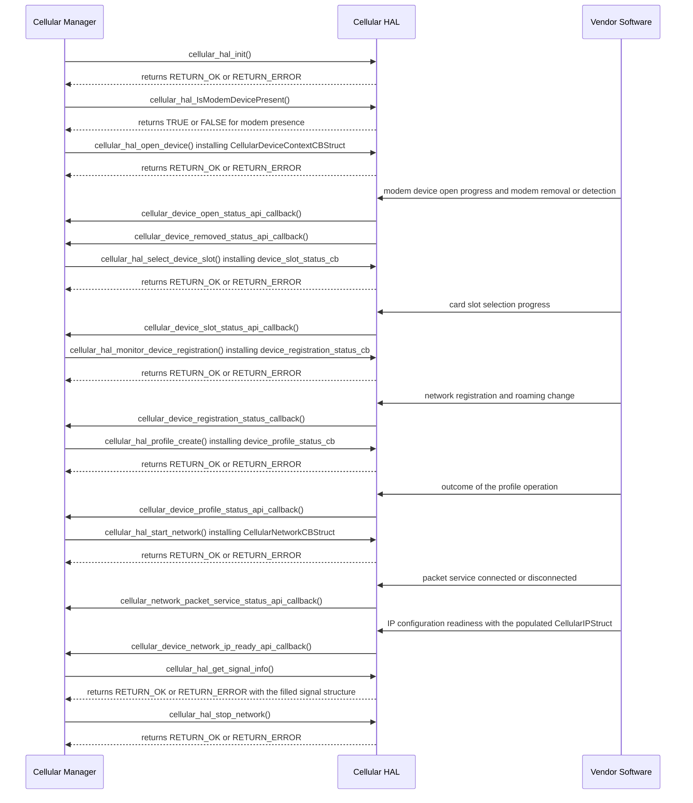

# Cellular Manager HAL Documentation

## Version History

| Date | Comment | Version |
| --- | --- | --- |
| 2024-06-06 | Initial release of the Cellular Manager HAL interface, migrated to GitHub. | 1.0.0 |
| 2024-10-09 | Removal of the `glib` headers from `cellular_hal.h`. | 1.0.1 |
| Unreleased | Specification restructured onto the common RDK-B HAL topic set. Asynchronous notification model, return codes, data types and the complete API surface documented. | Unreleased |

## Acronyms

- `HAL` \- Hardware Abstraction Layer
- `RDK-B` \- Reference Design Kit for Broadband Devices
- `OEM` \- Original Equipment Manufacturer
- `SIM` \- Subscriber Identity Module
- `UICC` \- Universal Integrated Circuit Card
- `ICCID` \- Integrated Circuit Card Identifier
- `IMEI` \- International Mobile Equipment Identity
- `MSISDN` \- Mobile Station International Subscriber Directory Number
- `PLMN` \- Public Land Mobile Network
- `APN` \- Access Point Name
- `PDP` \- Packet Data Protocol
- `NAS` \- Network Attachment Subsystem
- `RAT` \- Radio Access Technology
- `QMI` \- Qualcomm MSM Interface
- `PS` \- Packet Switched
- `CS` \- Circuit Switched
- `WAN` \- Wide Area Network

## Description

The diagram below describes a high-level software architecture of the Cellular HAL module stack.

Cellular HAL is an abstraction layer through which the Cellular Manager, the `RDK-B`
component this interface serves, interacts with vendor software to manage access to the cellular
network, manage cellular modem power configuration, expose radio resource information of the
cellular interface and manage `SIM` use.

This repository publishes the interface only. The implementation behind it is supplied by the `OEM`
or the modem vendor as a shared library.

## Optional Components

The following components are optional and are subject to the compile-time configuration of the
build, or to the caller's choice at the point of call.

- `QMI` library support, present unless the build defines `CELLULAR_MGR_LITE`, as described under
  `Variability Management`. `QMI` is the supported modem control library, so a vendor is not
  obliged to support a second one.

- The profile argument to `cellular_hal_start_network()` and `cellular_hal_profile_create()`. Where
  `pstProfileInput` is `NULL`, the implementation uses the default profile rather than rejecting the
  call, so a caller content with the default need not supply a profile.

## Component Runtime Execution Requirements

### Initialization and Startup

The initialization API below initializes the Cellular HAL layers and code.

- `cellular_hal_init()` \- initializes the Cellular HAL from a `CellularContextInitInputStruct`.
  It must be invoked before any other operation.

Three further calls belong to the startup path once initialization has completed.

- `cellular_hal_open_device()` \- instructs the lower layer to create and open the modem device,
  and installs the device-context callbacks described under `Asynchronous Notification Model`.
- `cellular_hal_IsModemDevicePresent()` and `cellular_hal_IsModemControlInterfaceOpened()` \-
  report whether the modem device is present and whether its control interface is open.

Third party vendors will implement appropriately to meet operational requirements.

### Threading Model

Cellular HAL is not thread safe. Any module which is invoking the Cellular HAL API should ensure
calls are made in a thread safe manner.

Vendors may create internal threads and events to meet their operational requirements. These are
responsible for synchronizing between the calls and the events, and must be cleaned up on closure.

### Process Model

All APIs are expected to be called from multiple processes.

### Memory Model

The caller and the module each own the memory they allocate.

#### Caller Responsibilities

- Allocate and own every buffer, structure and pointer variable passed to a call, at the size the
  API documentation states. Keep it allocated and unmoved, and an input also unmodified, until the
  implementation's use of it ends, not merely until the call returns:
  - the `CellularContextInitInputStruct` passed to `cellular_hal_init()`, the string passed to
    `cellular_hal_set_modem_preferred_radio_technology()` and every output argument, for as long as
    the caller uses the interface;
  - a profile passed to `cellular_hal_profile_create()`, `cellular_hal_profile_delete()` or
    `cellular_hal_profile_modify()`, until `cellular_device_profile_status_api_callback` reports the
    outcome;
  - a profile passed to `cellular_hal_start_network()`, while the network it started is running.
- Pass `cellular_hal_get_profile_list()` and `cellular_hal_get_available_networks_information()` the
  address of a pointer variable, which the implementation sets to the returned array; neither
  allocate nor free that array. Read the returned count before indexing it, copy the elements needed
  into the caller's own storage as soon as the call returns, and do not retain the array pointer.
- Copy any string or structure delivered to a callback that is needed after the callback returns,
  rather than retaining the pointer.
- Bound every read of a character array by its declared or allocated size, and rely on a terminator
  only where its documentation states one.

#### Module Responsibilities

- Handle and deallocate memory used for its internal operations.
- Release all internally allocated memory upon closure to prevent leaks.
- Zero-terminate a character array it fills, within the declared size, wherever that member's
  documentation states a terminator.

### Power Management Requirements

The Cellular HAL is not involved in any of the power management operations of the platform.
Modem and card power control is part of the functional surface instead:
`cellular_hal_set_modem_operating_configuration()` accepts `CELLULAR_MODEM_SET_LOW_POWER_MODE`, and
`cellular_hal_sim_power_enable()` powers a card slot on or off.

### Asynchronous Notification Model

Notifications are delivered by callback. The caller supplies a function pointer, either directly as
an argument or as a member of a callback container structure, to the operation that starts the
activity being reported on. There is no separate registration API, and an installed callback cannot
be removed, so the caller keeps every callback function it installs callable for as long as it uses
the interface.

Seven callback types are declared. Each is a `typedef` of a function returning `int`, and an
implementation of one returns `RETURN_OK` or `RETURN_ERROR` in the same way as a call into the
interface.

| Callback type | Installed by | Condition reported |
| --- | --- | --- |
| `cellular_device_open_status_api_callback` | `cellular_hal_open_device()`, as the `device_open_status_cb` member of `CellularDeviceContextCBStruct` | Modem device open progress, with the device name, the `WAN` interface name, a `CellularDeviceOpenStatus_t` and the modem operating mode |
| `cellular_device_removed_status_api_callback` | `cellular_hal_open_device()`, as the `device_remove_status_cb` member of `CellularDeviceContextCBStruct` | Modem removal or detection, as a `CellularDeviceDetectionStatus_t` against a device name |
| `cellular_device_slot_status_api_callback` | `cellular_hal_select_device_slot()`, directly | Card slot selection progress, as a `CellularDeviceSlotStatus_t` against a slot name, type and number |
| `cellular_device_registration_status_callback` | `cellular_hal_monitor_device_registration()`, directly | Network registration change, as a `CellularDeviceNASStatus_t` with the roaming status and the registered service type |
| `cellular_device_profile_status_api_callback` | `cellular_hal_profile_create()`, `cellular_hal_profile_delete()` and `cellular_hal_profile_modify()`, directly | Outcome of a profile operation, as a `CellularDeviceProfileSelectionStatus_t` against a profile identifier and `PDP` type |
| `cellular_network_packet_service_status_api_callback` | `cellular_hal_start_network()`, as the `packet_service_status_cb` member of `CellularNetworkCBStruct` | Packet service connected or disconnected, as a `CellularNetworkPacketStatus_t` against a device name and IP type |
| `cellular_device_network_ip_ready_api_callback` | `cellular_hal_start_network()`, as the `device_network_ip_ready_cb` member of `CellularNetworkCBStruct` | IP configuration readiness, as a `CellularDeviceIPReadyStatus_t` together with the populated `CellularIPStruct` |

A callback author handles every callback on the following terms:

- A callback may arrive on a vendor thread rather than the thread that installed it, so it
  synchronizes the caller's shared state and returns promptly.
- Notifications may be repeated or arrive out of order, and the caller tolerates both.

### Blocking calls

Cellular HAL APIs are expected to work synchronously: each call returns its result to the caller,
and the outcome of an operation that installs a callback is reported later through that callback.
Calls should complete within a time period commensurate with the complexity of the operation and in
accordance with any relevant specification, and any call that can fail due to the lack of a response
should have a timeout period in accordance with any relevant documentation.

`cellular_hal_init()` is expected to block if the hardware is not ready.

### Internal Error Handling

Each call reports its result synchronously in its return value, which a caller reads as follows.

| Return value | Meaning | Caller action |
| --- | --- | --- |
| `RETURN_OK` (`0`) | The call succeeded. For a call that installs a callback, the request was accepted. | Proceed. Where the call installed a callback, wait for it to report the outcome. |
| `RETURN_ERROR` (`-1`) | The call failed. It is the only failure code and identifies neither the cause nor whether a retry can succeed. | Apply the caller's own retry and escalation policy for the call made. |
| `TRUE` (`1`) or `FALSE` (`0`) | The answer of `cellular_hal_IsModemDevicePresent()` or `cellular_hal_IsModemControlInterfaceOpened()`, which return a value instead of a status. | Read the value as the answer to the query, not as success or failure. |

### Persistence Model

There is no requirement for the HAL to persist any setting information. The caller is responsible
for persisting any settings related to its implementation.

## Non functional requirements

The following non functional requirements should be supported by the Cellular HAL component.

### Logging and debugging requirements

The component should log all error and critical informative messages, preferably using `syslog`,
which helps to debug and triage issues and to understand the functional flow of the system. The use
of `printf` is discouraged unless `syslog` is not available.

The logging should be consistent across all HAL components.

If the vendor is going to log, it has to be logged into the `cellular_vendor_hal.log` file, which
can be placed in the `/rdklogs/logs/` directory.

Log levels follow the Linux standard logging system, in descending order of severity: `FATAL`,
`ERROR`, `WARNING`, `NOTICE`, `INFO`, `DEBUG` and `TRACE`. Each log entry carries a timestamp, the
log level and a message describing the event or condition.

Implementations must not log credentials, secrets, security-sensitive information, or other sensitive data.
This applies at every severity, including `DEBUG` and `TRACE`, and to error messages, crash artefacts
and telemetry. Where a message must identify the item an event concerns, it names the item and
omits its value. The Cellular Manager handles the values it receives through this interface on the
same terms.

### Memory and performance requirements

The Cellular HAL must not contribute disproportionately to memory or CPU utilization while
performing normal operations, and its consumption should be commensurate with the operation
required.

### Quality Control

An implementation should pass analysis with third-party tools such as `Coverity`, `Black Duck` and
`Valgrind` without reported issues. Neither the HAL implementation nor the vendor software beneath
it may introduce memory leaks or memory corruption.

Any change to a file listed under `Source References` obliges a review of this document by the
code owner listed in `.github/CODEOWNERS`.

### Licensing

The interface definition is licensed under the Apache License 2.0, with the full text in `LICENSE`
and the attribution notice in `NOTICE`. An implementation of this interface is expected to be
released under the Apache License 2.0.

### Build Requirements

The source code should be capable of, but not be limited to, building under the Yocto distribution
environment. The recipe should deliver a shared library named `cellularmanager.so`.

### Variability Management

Changes to the interface are controlled by versioning. Vendors implement a designated version of the
interface and move to later versions as their service agreements require. Each interface version
follows [Semantic Versioning 2.0.0](https://semver.org/spec/v2.0.0.html), and vendor code complies
with a specific version.

`CELLULAR_MGR_LITE` is the one compile-time variability point. It is supplied by the build and is
never defined by `cellular_hal.h`.

- When `CELLULAR_MGR_LITE` is **not** defined, `cellular_hal.h` defines `QMI_SUPPORT`, declaring that
  the `QMI` library is the supported modem control library.
- When `CELLULAR_MGR_LITE` **is** defined, `QMI_SUPPORT` is not defined, and any vendor code or
  caller conditional guarded by that symbol is excluded from the build.

The symbol adds or removes no declaration, data type or return code, so the API surface is the same
in both configurations.

### Platform or Product Customization

Platform- or product-specific behaviour belongs behind the vendor implementation of `cellular_hal.h`;
compile-time variability through `CELLULAR_MGR_LITE` is described under `Variability Management`.

## Interface API Documentation

All HAL function prototypes and datatype definitions are available in the
`cellular_hal.h` file.

1. Components and processes must include `cellular_hal.h` to make use of Cellular HAL
   capabilities.
2. Components and processes should add a linker dependency on `cellularmanager.so`.

### Theory of operation and key concepts

The Cellular HAL presents the cellular modem, its cards and its packet data connectivity as a flat
set of C functions over an implicit, singleton device context. A caller initializes the layer, opens
the modem device, selects a card slot, configures a `PDP` context profile and starts a packet data
network; thereafter it reads signal, cell, registration and statistics values, and receives
asynchronous notification of the conditions listed under `Asynchronous Notification Model`.

#### Object Lifecycles

| Aspect | Description |
| --- | --- |
| **Creation** | `cellular_hal_init()` initializes the Cellular HAL from a `CellularContextInitInputStruct`, configuring the resources and initial state required for operation. |
| **Usage** | The initialized instance is then used for further cellular operations, such as managing network connections, querying device status and handling cellular events. |
| **Destruction** | The interface declares no deinitialization call: `cellular_hal_stop_network()` stops a packet data network and does not tear down the layer. Applications handle clean-up as necessary when the cellular functionality is no longer required or before they terminate. |
| **Unique Identifiers** | Operations apply to the single, implicit device context, so HAL instances carry no identifier. Slots, profiles and `PDP` contexts are identified by a slot identifier, a profile identifier and a `PDP` context number, with the sentinels `CELLULAR_SLOT_ID_UNKNOWN`, `CELLULAR_PROFILE_ID_UNKNOWN` and `CELLULAR_PDP_CONTEXT_UNKNOWN` for an identifier that is not present. |

#### Method Sequencing

| Aspect | Description |
| --- | --- |
| **Initialization** | `cellular_hal_init()` precedes every other call, preparing the cellular module for subsequent commands and configuration. |
| **Logical order** | Post-initialization, methods such as `cellular_hal_open_device()` and `cellular_hal_start_network()` should be called to establish network connectivity. Configuration changes typically precede action commands, such as setting parameters before starting a session or applying changes. |
| **Callback installation** | A caller that needs a notification issues the operation that installs its callback, as listed under `Asynchronous Notification Model`. |

#### State-Dependent Behavior

| Aspect | Description |
| --- | --- |
| **Implicit state model** | The HAL maintains internal state implied by the functions available. For example, the modem must be initialized and in a ready state before certain actions can be performed. |
| **State-dependent methods** | Many operations implicitly require the modem to be in specific states. For example, network operations like `cellular_hal_start_network()` can only be executed successfully if the device is correctly initialized and not currently in an error state. |
| **Error handling** | Implementations check that each operation is performed in a valid state and report a call that cannot be performed with `RETURN_ERROR`, as described under `Internal Error Handling`. |

### Data Structures and Defines

Every public type below is declared in `cellular_hal.h` under the `CELLULAR_HAL_TYPES` documentation
group. A caller constructs the input structures and configuration enumerations itself, and reads the
output structures and status enumerations the interface fills. Field-level detail — units, valid
ranges and buffer sizes — is documented on each member in the header.

**Input structures a caller constructs:**

| Type | Represents |
| --- | --- |
| `CellularContextInitInputStruct` | The initialization input to `cellular_hal_init()`: the preferred IP family, the preferred access technology and an embedded interface profile. |
| `CellularProfileStruct` | A `PDP` context profile: profile identifier and type, `PDP` context number, `PDP` type, authentication and network configuration, profile name, `APN`, credentials, proxy address and port, and the roaming, `APN`-disabled and default-profile flags. Supplied to the profile calls and to `cellular_hal_start_network()`, and returned by `cellular_hal_get_profile_list()`. |
| `CellularDeviceContextCBStruct` | The callback container passed to `cellular_hal_open_device()`, carrying `device_open_status_cb` and `device_remove_status_cb`. |
| `CellularNetworkCBStruct` | The callback container passed to `cellular_hal_start_network()`, carrying `device_network_ip_ready_cb` and `packet_service_status_cb`. |

**Output structures the interface fills:**

| Type | Represents | Filled by |
| --- | --- | --- |
| `CellularIPStruct` | A complete IP configuration: `WAN` interface name, address, IP type, subnet mask, default gateway, two name servers, domains and the maximum transmission unit size. | `cellular_device_network_ip_ready_api_callback` |
| `CellularPacketStatsStruct` | Byte, packet and dropped-packet counters in both directions, with the maximum upstream and downstream bit rates. | `cellular_hal_get_packet_statistics()` |
| `CellularUICCSlotInfoStruct` | One card slot: slot and card enable flags, card presence, form factor, application type, card status, operator name, `ICCID` and `MSISDN`. | `cellular_hal_get_uicc_slot_info()` |
| `CellularSignalInfoStruct` | Signal measurements — received strength, received quality, received power, signal-to-noise ratio and transmit power. | `cellular_hal_get_signal_info()` |
| `CellLocationInfoStruct` | Cell location identifiers: global cell identifier, band information and serving cell identifier. | `cellular_hal_get_cell_location_info()` |
| `CellularCurrentPlmnInfoStruct` | The serving network: `PLMN` name, Mobile Country Code and Mobile Network Code, registration status, registered service type, roaming flag, area code and cell identifier. | `cellular_hal_get_current_plmn_information()` |
| `CellularNetworkScanResultInfoStruct` | One scan result: network name, Mobile Country Code, Mobile Network Code and whether the network is allowed. | `cellular_hal_get_available_networks_information()` |

**Configuration enumerations a caller supplies:**

| Type | Represents |
| --- | --- |
| `CellularIpFamilyPref_t` | Preferred IP family, as the `enIPFamilyPreference` member of `CellularContextInitInputStruct`. |
| `CellularPrefAccessTechnology_t` | Preferred access technology, as the `enPreferenceTechnology` member of `CellularContextInitInputStruct`, spanning second-generation packet data through to 5G New Radio. |
| `CellularProfileType_t` | Profile family — 3GPP or 3GPP2 — as a member of `CellularProfileStruct`. |
| `CellularPDPType_t` | `PDP` address type, as a member of `CellularProfileStruct` and as an argument to `cellular_device_profile_status_api_callback`. |
| `CellularPDPAuthentication_t` | `PDP` authentication method — none, Password Authentication Protocol or Challenge-Handshake Authentication Protocol — as a member of `CellularProfileStruct`. |
| `CellularPDPNetworkConfig_t` | Source of the `PDP` network configuration, as a member of `CellularProfileStruct`. |
| `CellularModemOperatingConfiguration_t` | The operating command applied by `cellular_hal_set_modem_operating_configuration()`, and the operating mode reported by `cellular_device_open_status_api_callback`. |
| `CellularNetworkIPType_t` | IP family of a packet data network, taken by `cellular_hal_start_network()` and `cellular_hal_stop_network()`, carried in `CellularIPStruct` and reported by `cellular_network_packet_service_status_api_callback`. |
| `CellularUICCFormFactor_t` | Physical card form factor, as a member of `CellularUICCSlotInfoStruct`. |
| `CellularUICCApplication_t` | Card application type — Universal, IP Multimedia or embedded Subscriber Identity Module — as a member of `CellularUICCSlotInfoStruct`. |

**Status enumerations the interface reports:** listed under `State Diagram`, with their members
and the call or callback that reports each.

**Callback types:** listed under `Asynchronous Notification Model`, with the call that installs
each and the condition each reports. `CellularDeviceContextCBStruct` and
`CellularNetworkCBStruct` above are the containers that carry four of them.

**Valued macros:**

| Macro | Value | Purpose |
| --- | --- | --- |
| `RETURN_OK` | `0` | Success return code. |
| `RETURN_ERROR` | `-1` | Failure return code. |
| `TRUE` | `1` | Returned by `cellular_hal_IsModemDevicePresent()` and `cellular_hal_IsModemControlInterfaceOpened()`, and the set value of the `unsigned char` flags in the interface's structures. Defined only if not already defined. |
| `FALSE` | `0` | The complement of `TRUE`, on the same terms. |
| `BUFLEN_8`, `BUFLEN_32`, `BUFLEN_64`, `BUFLEN_128`, `BUFLEN_256` | `8`, `32`, `64`, `128`, `256` | Buffer length constants, each defined only if not already defined. The buffer size each argument requires is documented on that argument in the header. |
| `CELLULAR_PROFILE_ID_UNKNOWN` | `-1` | Sentinel for a profile identifier that is not present. |
| `CELLULAR_SLOT_ID_UNKNOWN` | `-1` | Sentinel for a slot identifier that is not present. |
| `CELLULAR_PDP_CONTEXT_UNKNOWN` | `-1` | Sentinel for a `PDP` context that is not present. |
| `CELLULAR_PACKET_DATA_INVALID_HANDLE` | `0xFFFFFFFF` | Sentinel for an invalid packet data handle. |

`CELLULAR_MGR_LITE` and `QMI_SUPPORT` are described under `Variability Management`.

### API Surface

`cellular_hal.h` declares 36 functions, grouped below by functional area. The argument ranges,
buffer sizes, pre-conditions and per-code return semantics of each call are documented on its
declaration in `cellular_hal.h`.

**Modem detection and initialization:**

- `cellular_hal_IsModemDevicePresent()` \- reports whether a modem device is present, returning
  `TRUE` or `FALSE` rather than a status.
- `cellular_hal_init()` \- initializes the Cellular HAL from a `CellularContextInitInputStruct`.

**Device and control-interface lifecycle:**

- `cellular_hal_open_device()` \- instructs the lower layer to create and open the modem device,
  installing the device open and device removed callbacks.
- `cellular_hal_IsModemControlInterfaceOpened()` \- reports whether the modem control interface is
  open, returning `TRUE` or `FALSE` rather than a status.

**SIM, UICC and slot handling:**

- `cellular_hal_select_device_slot()` \- selects the card slot to use, reporting progress through the
  slot status callback.
- `cellular_hal_sim_power_enable()` \- powers a card slot on or off by slot identifier.
- `cellular_hal_get_total_no_of_uicc_slots()` \- reports how many `UICC` slots the device has.
- `cellular_hal_get_uicc_slot_info()` \- fills a `CellularUICCSlotInfoStruct` for one slot index.
- `cellular_hal_get_active_card_status()` \- reports the active card's status as a
  `CellularUICCStatus_t`.

**Network registration monitoring:**

- `cellular_hal_monitor_device_registration()` \- instructs the lower layer to monitor network
  registration and installs the registration status callback.

**Profile lifecycle:**

- `cellular_hal_profile_create()` \- creates a `PDP` context profile.
- `cellular_hal_profile_delete()` \- deletes the supplied profile.
- `cellular_hal_profile_modify()` \- modifies the supplied profile.
- `cellular_hal_get_profile_list()` \- returns the configured profiles together with a count.

**Network start and stop:**

- `cellular_hal_start_network()` \- starts the packet data network for an IP type and installs the
  packet service status and IP ready callbacks.
- `cellular_hal_stop_network()` \- stops the packet data network for the given IP request type.

**Radio resource and signal information:**

- `cellular_hal_get_signal_info()` \- fills a `CellularSignalInfoStruct` with the current signal
  measurements.
- `cellular_hal_get_cell_location_info()` \- fills a `CellLocationInfoStruct` with the cell and band
  identifiers.
- `cellular_hal_get_packet_statistics()` \- fills a `CellularPacketStatsStruct` with the traffic
  counters and maximum bit rates.
- `cellular_hal_get_current_modem_interface_status()` \- reports the modem interface status as a
  `CellularInterfaceStatus_t`.
- `cellular_hal_get_current_plmn_information()` \- fills a `CellularCurrentPlmnInfoStruct` with the
  serving network's identity, registration status and registered service type.

**Modem configuration and attach:**

- `cellular_hal_set_modem_operating_configuration()` \- applies an operating command to the modem:
  online, offline, low power mode, reset or factory reset.
- `cellular_hal_set_modem_network_attach()` \- attaches the modem to the network.
- `cellular_hal_set_modem_network_detach()` \- detaches the modem from the network.

**Identity queries:**

- `cellular_hal_get_device_imei()` \- reads the device `IMEI` into a caller-supplied buffer.
- `cellular_hal_get_device_imei_sv()` \- reads the device `IMEI` together with its software version
  digits.
- `cellular_hal_get_modem_current_iccid()` \- reads the `ICCID` of the active card.
- `cellular_hal_get_modem_current_msisdn()` \- reads the `MSISDN` of the active subscription.
- `cellular_hal_get_modem_firmware_version()` \- reads the modem firmware version.

**Network scan and radio access technology:**

- `cellular_hal_get_available_networks_information()` \- returns the networks found by a scan,
  together with a count.
- `cellular_hal_get_modem_preferred_radio_technology()` \- reads the preferred `RAT`.
- `cellular_hal_set_modem_preferred_radio_technology()` \- sets the preferred `RAT`.
- `cellular_hal_get_modem_current_radio_technology()` \- reads the `RAT` currently in use.
- `cellular_hal_get_modem_supported_radio_technology()` \- reads the set of RATs the modem supports.

**Reset:**

- `cellular_hal_modem_factory_reset()` \- resets the modem to factory defaults.
- `cellular_hal_modem_reset()` \- resets the modem.

### Sequence Diagram

The exchange below shows a representative bring-up, a read and a teardown between the Cellular
Manager, the Cellular HAL and the vendor software.

### State Diagram

The interface defines status values but no transitions between them, so no state diagram is drawn.
The status enumerations it reports are the following.

| Enumeration | Members | Reported by |
| --- | --- | --- |
| `CellularInterfaceStatus_t` | `IF_UP`, `IF_DOWN`, `IF_UNKNOWN`, `IF_DORMANT`, `IF_NOTPRESENT`, `IF_LOWERLAYERDOWN`, `IF_ERROR` | `cellular_hal_get_current_modem_interface_status()` |
| `CellularRegistrationStatus_t` | `DEVICE_REGISTERED`, `DEVICE_NOT_REGISTERED` | The `registration_status` member of `CellularCurrentPlmnInfoStruct`, filled by `cellular_hal_get_current_plmn_information()` |
| `CellularUICCStatus_t` | `CELLULAR_UICC_STATUS_VALID`, `CELLULAR_UICC_STATUS_BLOCKED`, `CELLULAR_UICC_STATUS_ERROR`, `CELLULAR_UICC_STATUS_EMPTY` | `cellular_hal_get_active_card_status()`, and the `Status` member of `CellularUICCSlotInfoStruct` |
| `CellularDeviceDetectionStatus_t` | `DEVICE_DETECTED`, `DEVICE_REMOVED` | `cellular_device_removed_status_api_callback` |
| `CellularDeviceOpenStatus_t` | `DEVICE_OPEN_STATUS_NOT_READY`, `DEVICE_OPEN_STATUS_INPROGRESS`, `DEVICE_OPEN_STATUS_READY` | `cellular_device_open_status_api_callback` |
| `CellularDeviceSlotStatus_t` | `DEVICE_SLOT_STATUS_NOT_READY`, `DEVICE_SLOT_STATUS_SELECTING`, `DEVICE_SLOT_STATUS_READY` | `cellular_device_slot_status_api_callback` |
| `CellularDeviceNASStatus_t` | `DEVICE_NAS_STATUS_NOT_REGISTERED`, `DEVICE_NAS_STATUS_REGISTERING`, `DEVICE_NAS_STATUS_REGISTERED` | `cellular_device_registration_status_callback` |
| `CellularDeviceNASRoamingStatus_t` | `DEVICE_NAS_STATUS_ROAMING_OFF`, `DEVICE_NAS_STATUS_ROAMING_ON` | `cellular_device_registration_status_callback` |
| `CellularModemRegisteredServiceType_t` | `CELLULAR_MODEM_REGISTERED_SERVICE_NONE`, `CELLULAR_MODEM_REGISTERED_SERVICE_PS`, `CELLULAR_MODEM_REGISTERED_SERVICE_CS`, `CELLULAR_MODEM_REGISTERED_SERVICE_CS_PS` | `cellular_device_registration_status_callback`, and the `registered_service` member of `CellularCurrentPlmnInfoStruct` |
| `CellularContextProfileStatus_t` | `PROFILE_STATUS_INACTIVE`, `PROFILE_STATUS_ACTIVE` | Reported by no call and carried in no structure. |
| `CellularDeviceProfileSelectionStatus_t` | `DEVICE_PROFILE_STATUS_NOT_READY`, `DEVICE_PROFILE_STATUS_CONFIGURING`, `DEVICE_PROFILE_STATUS_READY`, `DEVICE_PROFILE_STATUS_DELETED` | `cellular_device_profile_status_api_callback` |
| `CellularDeviceIPReadyStatus_t` | `DEVICE_NETWORK_IP_NOT_READY`, `DEVICE_NETWORK_IP_READY` | `cellular_device_network_ip_ready_api_callback` |
| `CellularNetworkPacketStatus_t` | `DEVICE_NETWORK_STATUS_DISCONNECTED`, `DEVICE_NETWORK_STATUS_CONNECTED` | `cellular_network_packet_service_status_api_callback` |

## Source References

- [rdkcentral/rdkb-halif-cellular/include/cellular_hal.h](https://github.com/rdkcentral/rdkb-halif-cellular/blob/develop/include/cellular_hal.h) — interface declarations, data types, return codes and callback types
- [rdkcentral/rdkb-halif-cellular/CHANGELOG.md](https://github.com/rdkcentral/rdkb-halif-cellular/blob/develop/CHANGELOG.md) — release history recorded under `Version History`
- [rdkcentral/rdkb-halif-cellular/.github/CODEOWNERS](https://github.com/rdkcentral/rdkb-halif-cellular/blob/develop/.github/CODEOWNERS) — owner responsible for reviewing this document
- [rdkcentral/rdkb-halif-cellular/LICENSE](https://github.com/rdkcentral/rdkb-halif-cellular/blob/develop/LICENSE) — Apache License 2.0
- [rdkcentral/rdkb-halif-cellular/NOTICE](https://github.com/rdkcentral/rdkb-halif-cellular/blob/develop/NOTICE) — attribution notice named under `Licensing`
